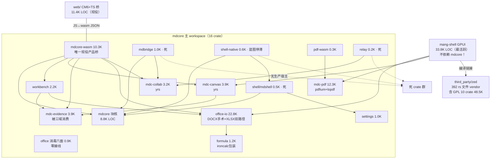

# mdcore 阶段性代码审计与架构决策报告

- **审计对象**：`github.com/mmqz/mdcore`，main 分支 `96596d7`（Merge PR #214）
- **审计日期**：2026-11-04
- **审计性质**：只读代码审计 + 架构裁决（不实施修复；源码零改动，全部产出为新增文档）
- **审计方法**：六轮递进（工程基线 → Core 状态/事务 → 领域专项 → 质量/安全/测试 → 对标 → 裁决），16 个并行深审代理 + 本地真实测试运行 + CI/门禁复核，共 16 份模块笔记（见附录 E 索引，随本报告同分支提交）
- **基线**：工作区干净、无子模块、414 commits、开放 PR 2 个（#218 keymap、#216 fmt 门禁复位）；`rust-toolchain.toml` 钉住 1.99.0 + wasm32 + rustfmt/clippy

---

## 0. 证据等级与纪律合规声明

每个问题标注置信级别：**已确认**（代码级证据链 + 多代理交叉或本地复现）、**高度怀疑**（代码推理成立但未运行验证）、**需外部环境验证**（需真机/外部软件）、**设计偏好**。

本地实证记录（附录 B 详）：
- `cargo test` 按钉住工具链 1.99.0 在 Linux 实跑 **1,241 个测试全部通过**（mdcore 240 / office 链 457 / pdf+lopdf 182 / 其余 362），未运行：mdcore-wasm、pdf-wasm（wasm 目标）、shell-native（GTK sysroot）、mang-shell（GPUI 系统依赖）。
- `cargo fmt --all -- --check` 在 main 实测 **977 行漂移**（canvas/pdf 为主）——fmt 门禁事实失效，与 PR #216 自述一致。
- `compliance/scan.sh` 被合规审计代理在 HEAD 实跑 **exit 1（5 命中）**。
- 仓库在审计全程 `git status` 保持干净；本分支仅新增 `audit/` 目录文档，未修改任何源码、未合并 main、未创建 PR。

---

## 1. Executive Summary

**一句话总评：mdcore 是一个工程纪律罕见之高的自研文档引擎仓——测试密度、证据文化、自登记债务的水准都远超典型 v0 项目；但它当前真正的危机不在代码质量，而在产品形态：仓里长出了「一个引擎 + 两个互不相通的编辑器前端」，且主线 GUI 被 48.5K 行 GPL 代码锁死了商业路线，治理文档与门禁体系已落后代码现实一个身位。**

### 1.1 当前工程整体状态

- **引擎域（mdcore 主 workspace，16 crate，约 6.7 万行 src）分层纪律优秀**：三域（MD/PDF/Office）零交叉编译依赖、无循环依赖、Core 未被外围反向污染、产品代码零 unsafe、敌意路径自研代码零裸 panic。
- **产品域是双轨现实**：mdcore 的唯一现役产品路径是 web CM6 + wasm 桥（57 commits 活跃）；而仓内最活跃的是 mang-shell（GPUI + Zed text::Buffer，106 commits/2 周，33.8K LOC）——它**完全不依赖 mdcore**，用 vendor 进来的 Zed GPL 栈自建了第二个编辑器。README/CONTRACT/gates.md 对 mang-shell **零提及**，架构图仍画着停滞的 shell-native（wry/tao 蓝图，568 LOC）。
- **质量保障呈「马赛克」**：引擎内部防线（Office 容器三门、collab 敌意面、PDF 限额、事务原子性）真实且负向测试扎实；但 fmt 门禁在 main 失效（实测 977 行漂移，历史上第三次事故）、204 件真实语料 sweep **静默空转恒绿零断言**、CI 只测 9/17 crate、web 桥 24 套件与 wasm 运行时零 CI、clippy 无门禁、合规 scan.sh 当前是红的。

### 1.2 最重要的结构性问题（按影响排序）

1. **编辑器双轨**：mdcore 语义核（op log/undo/anchor/身份/证据）与 mang-shell 的 Zed text 栈之间无任何共享抽象；MD 语义（undo/折叠/围栏/字数）两轨各写一份。这是「一号架构决策」悬置的直接后果。
2. **GPL 闭源阻塞**：编译进 mang-shell 二进制的 GPL crate 10 件 / 48,562 LOC（ui 29.8K + text 6.7K + theme 6.0K + rope 4.2K…）+ 15 件 Zed 上游 SVG 经 `include_bytes!` 内嵌且超出 NOTICES 记账。仓根 LICENSE = GPL-3.0-or-later，与 COMPLIANCE.md「GPL 零容忍」、README「私有产品仓」三方互斥。主 workspace 408 包一手普查 **0 GPL**——「整体 GPL」对主仓是过度声明，但 mang-shell 主线确被锁死。
3. **治理脱锚**：README 平台矩阵/用例数字（850+ vs 静态 1220+ vs mang-shell 563）、架构图、CONTRACT、SBOM 声称全部落后于 HEAD；唯一可实跑的门禁（scan.sh）此刻正红。
4. **消费倒挂**：多项最高质量资产零产品消费方——XLSX 高保真 XlsxEditor（部件字节透传，1,806 行）、PDF S2/S6 open_scan 安全扫描、mdc-office 消毒六面、collab 8.4K LOC 协作域（用户编辑流从未进入协作）。

### 1.3 最严重的正确性风险（P0，均为已确认）

| # | 风险 | 一句话 |
|---|---|---|
| P0-1 | save→open 身份重编号 + undo 物化 ID 撞号 | 活树出现重复 BlockId，跨会话 undo 可破坏核心状态（详见 §3） |
| P0-2 | docx-rs 读路径真实语料 panic | Word 365 常见文档打开即崩（GUI 入口无 catch_unwind），未保存编辑丢失 |
| P0-3 | PDF forms「增量写」实为全量重写 | 在「填已签名投标函」目标场景静默摧毁既有签名 |
| P0-4 | web 桥 list_item 内 Enter 文本损坏 | 唯一现役产品路径上的高频用户可见数据损坏 |
| P0-5 | TSV 剪贴板公式注入 | 敌意 xlsx → 复制 → 粘贴进 Excel 即触发 DDE/钓鱼载荷（防护函数存在但从未接线） |

### 1.4 当前是否适合继续扩展？

**语义核值得继续，但不适合立即继续扩展。** 建议插入一个 **6–8 周的架构治理窗口**：先修复 5 个 P0、止血门禁体系（fmt/语料空转/scan.sh/CI 扩容）、完成双轨收敛与 GPL 商业化裁决，再恢复能力面扩展。理由：对标结论（§5）表明 mdcore 的差异化价值恰恰在语义层（可撤销 op 流、跨重写锚点、AI/人溯源、证据失效降级、字节级保真）——这些在 CM6/ProseMirror/Zed/ONLYOFFICE 全谱系中**全部缺失**；但身份层 P0 不修，语义核的一切承诺（跨会话 undo、协作寻址、证据定位）都是未兑现的期票。

### 1.5 下一阶段建议（三方向，详见 §7 路线图）

1. **身份与保真层修复 + 门禁止血**（P0 集群 + fmt/语料/CI）。
2. **消费面接线**——用最小代价激活已建成的高保真资产（X-2、open_scan、sanitize、协作桥 PoC）。
3. **双轨收敛与 GPL 商业化裁决**——这是决定产品形态的分岔口：收敛到 mdcore 核 +（web 桥或 Tauri 化）还是继续 mang-shell GPUI 路线（承担 GPL 或替换 48.5K LOC）。

---

## 2. 当前架构图

### 2.1 真实 crate 依赖图（HEAD 实测，非 README 抄绘）



**读图要点**：① mdcore 块核的消费者是 wasm 桥 / mdbridge / shell / shell-native——其中三个属「死 crate 群」（无产品消费者）；② mang-shell（最活跃 GUI）只连 office-io/pdf/canvas，**不连 mdcore**；③ evidence 被三域消费，是真正的共享资产。

### 2.2 核心状态流与文档编辑调用链（mdcore 线）

```text
用户操作（CM6 事务 / AI 批量 / RPC）
  → web/src/main.ts 桥（apply_ops JSON, UTF-16↔码点换算对）
  → mdcore-wasm（JSON 边界）
  → Core::apply_ops 事务入口（lib.rs）
      ├─ 备份整树（clone——P1 内存根因）
      ├─ 逐 op 应用：Op Log 追加 + BlockTree(ropey per-block) 变异
      ├─ 失败 → 回滚备份（原子性已验证）
      └─ 成功 → revision 推进 + Event 入队 + 撤销栈（inverses 前插）
  → drainEvents → JS 侧 BlockMap / CM6 同步（快路径 textOffset 平移）
  → Undo/Redo（单栈穿透；System 类不入栈——ADR-B4）
  → save：markdown 序列化 + meta{revision, history(含物化 ID 的 inverses)}
  → reopen：from_markdown 重解析 → 先序重发 ID 1..n ⚠ 与 history 旧 ID 撞号（P0-1）
```

### 2.3 三域独立边界与双轨现实

```text
┌─ MD 域 ─────────────────────────────┐  ┌─ Office 域 ────────────────────┐  ┌─ PDF 域 ─────────────┐
│ mdcore 块核（身份/撤销/锚点）          │  │ office 消毒（悬空）              │  │ mdc-pdf 双引擎        │
│ + web CM6 桥（现役）                  │  │ office-io 手术编辑（Rust 独一份）│  │ pdfium 读渲染         │
│ + mang-shell Zed text（平行宇宙）⚠    │  │ calamine/rust_xlsxwriter/      │  │ lopdf 增量写（自研）   │
│                                      │  │ ironcalc/formula 包装编排       │  │ forms/stamp 旁路 ⚠    │
└──────────────────────────────────────┘  └────────────────────────────────┘  └──────────────────────┘
              Canvas 域：mdc-canvas + yrs（自研 store，文本无字形 ⚠）
              协作/证据域：collab（平行宇宙）· relay（死）· evidence（活，三域消费）· workbench（活）
```

### 2.4 Web 与 Native Host 调用关系（现状 vs README 声称）

| 宿主路径 | README 声称 | HEAD 现实 | 活跃度 |
|---|---|---|---|
| web/ CM6 + mdcore-wasm | 主桥 | **唯一消费 mdcore 的现役路径** | 57 commits/90天 |
| mang-shell（GPUI） | 未提及 | 实际主产品面（编辑/DOCX/XLSX/PDF/Canvas 视图） | 106 commits/2 周 |
| shell-native（tao+wry+GTK3） | 架构图主角 | 568 LOC 蓝图 | 2026-10-26 后停滞 |
| mdbridge / mdshell / relay | 契约层/中继 | 死 crate 群（仅测试消费） | ≈0 |

---

## 3. 问题清单

> 完整证据链（文件:行号、调用链、相关测试、置信级别）见 `audit/notes/` 对应笔记；本表为裁决级汇总。严重程度定义：P0=数据丢失/严重安全/核心状态破坏；P1=核心正确性/架构边界/长期维护重大问题；P2=明显技术债/性能/兼容；P3=一般改进。

### P0（5 项，全部已确认）

| ID | 模块 | 位置 | 问题 | 影响 | 证据 | 建议 |
|---|---|---|---|---|---|---|
| P0-1 | mdcore 身份层 | document.rs:253 · op.rs:358 · tree.rs:154-156 | save→open 重解析先序重发 ID，undo 条目 inverses 携旧会话物化 ID 回放，`register()` 无撞号守卫静默覆盖 | 活树重复 BlockId → id_index 先注册者失联、锚点错块、快照 validate 毒化拒收；t3_reuse_locks.rs:145-186 已把此锁为「现状」未修 | 双代理独立交叉确认 | register 加守卫（撞号拒/重映射）+ ID 持久化或 undo 条目去物化，二选一成体系修 |
| P0-2 | DOCX 读路径 | docx-rs 0.4.22（依赖层）· mang-shell/src/editor/docx_doc.rs:171 | 真实语料 4 处 panic（word365 styles 三件 index OOB + strict 件 ParseFloat unwrap）+ 属性族 22/23 拒读；GUI 入口只 map_err 无 catch_unwind | 用户打开常见 Word 文档即崩溃（含未保存编辑丢失）；wasm 面=trap | test-artifacts/health-check/{BASELINE,results,REPORT} 三件实证，基线已锁但未修 | 读入口 catch_unwind 兜底 + docx-rs 上游修复跟踪/换读路径评估 |
| P0-3 | PDF forms | pdf/src/forms.rs:30-38,1040-1052 | 模块文档与 `save()` 均声称「增量修订、前缀逐位不变、既有签名仍有效」，实现为 lopdf `Document::save_to` 全量重写，无任何前缀测试 | 目标场景「填已签名投标函」静默摧毁既有签名（PAdES 硬约束违反） | 代码直读 + 零测试佐证 | 实现真增量追加（参照 writer_lopdf.rs 三层守卫）或如实降级声称并拒写已签名文档 |
| P0-4 | web 桥 | web/src/main.ts:210/317,872-886,1144 | 快路径编辑后 `BlockMap.byId.textChars` 永不更新，`handleEnter` 以之为 ReplaceText 区间端点 | list_item 内打字后行内 Enter → 错误切分 → 中段文本重复/错位（最简例 `- ab` 插 X 后 Enter）；全仓零覆盖 | 代码级三处互证（禁 build 未实测，置信高） | 修 textChars 增量维护 + 补 e2e 断言（Enter 前后全文比对） |
| P0-5 | 安全：TSV 公式注入 | web/src/xlsx_grid.ts:945-966 · office/src/sanitize/csv_formula.rs | `guard_csv_cell` 消毒函数存在且有测试，但 web 网格 `onCopy` 把敌意单元格显示文本原样写剪贴板 TSV，从未接线 | 用户复制→粘贴进 Excel 即执行 `=cmd|` DDE / `=HYPERLINK` 钓鱼；活产品路径 | 双代理独立发现（01/06 号笔记均漏，12 号补上） | onCopy 出口调用消毒（=,+,-,@ 前缀改写）+ 负向 e2e |

### P1（20 项）

| ID | 模块 | 位置 | 问题 | 影响 | 置信 |
|---|---|---|---|---|---|
| P1-1 | mdcore marks | markdown.rs:8 · op.rs:346-364 | 行内格式双轨（node.marks vs 源文本字面 `**`）；save/open 与 adopt_external 静默丢 marks；结构 op 全链路无 marks 字段（delete→undo 加粗全丢） | 用户可见格式丢失；「undo 精确复原」承诺未兑现 | 已确认 |
| P1-2 | mdcore anchor | anchor.rs:11 · r17_id_boundaries.rs:419-447 | 无偏移平移映射，`sync_from_markdown` 按位对齐使 ID 跟位置不跟内容 | 无 expect 的 ByAnchor 可静默改写错误内容（锚点只是乐观并发而非稳定寻址） | 已确认 |
| P1-3 | 编辑器双轨 | mang-shell/Cargo.toml（零 mdcore 依赖）· buffer.rs:1-51 | mang-shell 用 Zed GPL `text::Buffer` 自建第二编辑器；MD 语义两轨各写一份 | 一号架构决策悬置；双倍维护税；语义核价值无法传导到主线 GUI | 已确认 |
| P1-4 | GPL 商业阻塞 | third_party/zed（10 crate 48,562 LOC）· assets.rs:1-3（15 SVG 内嵌）· LICENSE=GPL-3.0 | mang-shell 二进制实证含 GPL 面；与 COMPLIANCE「零容忍」/「私有产品仓」三方互斥 | 闭源分发被主线 GUI 法律性锁死；替换手术核心=ui/theme 36.1K LOC | 已确认（Cargo.lock+上游逐字节比对） |
| P1-5 | XLSX 消费倒挂 | xlsx_edit.rs（XlsxEditor）· mdcore-wasm/xlsx 导出 | 高保真部件透传编辑器零产品消费方；产品路径走有损 rebuild（丢样式/图表/条件格式/数据验证） | 1,806 行高保真资产闲置；用户实际得到次品导出 | 已确认 |
| P1-6 | XLSX 原位编辑无重算 | xlsx_edit.rs:21-24 | 只「拒改公式格」，改数据格后依赖公式 `<v>` 缓存陈旧、calcChain 透传旧账 | 读改写产物在 Excel 打开显示陈旧值 | 已确认 |
| P1-7 | 消毒六面+URL 策略零接线 | office/src/sanitize/* · docx_import.rs:204-243 | 六面消毒与 url_policy 全部无产品调用方；敌意 docx `javascript:` 超链接直转 GFM markdown 导出 | 防护函数存在但产品路径绕过（B-1~B-7 共 7 条绕过清单见笔记 12） | 已确认 |
| P1-8 | md 深度无门 | markdown.rs（无深度门）vs html.rs:256（有 256 门） | 深嵌套敌意 md → 树深无界 → blocks_json() 等七处递归消费者栈溢出 | wasm trap / 崩溃（html 侧有门、markdown 侧双标） | 已确认 |
| P1-9 | RPC 沙箱旁路 | mang-shell/src/rpc.rs:959,1213 | `open_file` 任意路径读入 UI、`save_as` 任意路径写盘；socket 无认证 + /tmp 回退端点默认权限 | 本机任意用户可组合读写原语（27 命令仅 8 条有沙箱） | 已确认 |
| P1-10 | DOCX 结构丢失 | docx.rs:3513 · sdt 读面 | 多节文档仅取末节 sectPr 页眉页脚（中段节静默丢）；w:sdt 内容结构性丢弃（Word 惯例 TOC 包 sdt → 整块不可读） | 真实 Word 文档信息丢失 | 已确认 |
| P1-11 | PDF 写面安全门缺失 | stamp.rs:690-773 · pdf_doc.rs · forms.rs:394 | stamp 无 S5 加密门/S3 输入门（对加密档盖章静默损坏）；桌面读路径不接 S2/S6 open_scan；PdfForm::read 只查 is_encrypted 不查 was_encrypted | 全写面唯一裸奔入口；S2.4 警告合同仅 wasm 路径交付 | 已确认 |
| P1-12 | PDF worker 线程累积 | worker.rs:363-371 | 换代对永挂 C 调用的旧代线程 detach | 反复敌意超时 → 线程+字节快照无上界累积 | 已确认 |
| P1-13 | collab 平行宇宙 | mdcore-wasm/Cargo.toml:26 · web/collab_channel.ts:443 | 用户编辑的 WasmCore 文档永不进入协作；collab+mdbridge+relay 8.4K LOC 仅 `__collab*` 探针驱动 | 协作是高质量期货，零产品兑现 | 已确认 |
| P1-14 | CI/门禁体系缺口 | .github/workflows/*（仅 2 Windows） | 只测 9/17 crate（mdcore-wasm 148 测试不在 CI）；wasm 只编译不运行；web 24 套件 ≈389 checks 零 CI 且 results.json gitignore；无 fmt/clippy/Linux；语料 sweep 空转恒绿；fmt 实测 977 行漂移 | 「绿」只证明 9 crate 内部自洽；用户可见正确性证据全在环境门后 | 已确认（多项本地复现） |
| P1-15 | 合规体系失效 | scan.sh（实跑 exit 1）· SBOM 不在仓 · NOTICES 1/10 抽中 | README「每次提交前 PASS 才可合入」纪律失守 8 天无人知；SBOM 367 声称不可复核；NOTICES v1.6 停在 Zed 搬运前；mang-shell 无 SBOM | 合规声称与现实脱钩；闭源/分发决策无可靠底账 | 已确认（scan.sh 本地实跑） |
| P1-16 | Canvas 文本无字形 | canvas/src/render.rs:2197-2221 | 路线 A′ 光栅路径无字形渲染，.canvas 标签上屏为占位空框 | GUI 文本节点不可读（P0 级用户可见缺陷，因非数据损坏列 P1 顶部） | 已确认 |
| P1-17 | #164 修复未收口 | mang-shell/src/editor/mod.rs:4183 等 4 处 | 根因（refresh_caches O(doc)）已由 #205 增量围栏消除，但每帧 `to_plain_text()` 全文物化等残项仍在；修复后无端到端复测；perf_meas.sh 仅 debug 构建 | 性能红线状态未知；324ms/1765ms 登记已过时 | 已确认（残项）/高度怀疑（红线） |
| P1-18 | wasm 时钟恒 0 | mdcore-wasm（缺 set_clock_ms 调用） | wasm32 默认时钟 0 → 合并窗失效，全会话击键并成一条 undo 条目 | undo 粒度坍塌（用户一次 undo 撤掉整段工作） | 已确认 |
| P1-19 | 整树 clone | mdcore lib.rs:297/380/1015 | 每事务整树 clone（slots arena+id_index 深拷贝） | 每键 O(全树) 分配；10MB 文档 wasm 425MB 高水位根因（R22-b 登记未治理） | 已确认 |
| P1-20 | vendored Zed 无跟踪 | third_party/zed/PROVENANCE.md | 无 submodule/remote，快照钉 1663af4，third_party 不在任何 CI，手工四步升级 | 安全/修复无法跟随上游；GPUI 已 crates.io 化（Apache 0.2.2）可解跟踪不解 GPL | 已确认 |

### P2（22 项精选）

| ID | 模块 | 位置 | 问题 |
|---|---|---|---|
| P2-1 | mdcore | lib.rs:905-962 | `undo()/redo() -> Option` 吞错：空栈与历史损坏不可分辨 |
| P2-2 | mdcore | op.rs:115-119 | 公开面可注入 `InsertBlock.id=Some` 无撞号守卫（wasm JSON 直达） |
| P2-3 | mdcore | op.rs（SetMark 代数） | 子区间 remove 静默 no-op（但发事件/bump revision）；SetMark×并发文本编辑覆盖窗口（ops.rs:502-505 自认） |
| P2-4 | mdcore | lib.rs:137-139 | `pub tree/history/log` 公有字段绕过「apply_ops 唯一变异入口」承诺 |
| P2-5 | mdcore | markdown.rs:20-28 | 渐进 chunk 完整性只防 fence，quote/list/table 跨块切分静默破坏等价性 |
| P2-6 | mdcore | — | save 不持久化 revision log，重开后「重放==实时」跨会话不成立 |
| P2-7 | web 桥 | main.ts:890-900,970 | fullResync 失败仍推进 syncedRev + 旧树重建 map → 分叉不自愈 |
| P2-8 | web 桥 | main.ts:1679-1690 | `__inject_chunk(first=false)` 无 ingestExtend → 追加区每键 O(doc) |
| P2-9 | mdcore-wasm | — | 无 console_error_panic_hook；apply_ops backup 回滚仅 Err 路径，panic 后核可半改（生产可达 panic≈0） |
| P2-10 | DOCX | docx.rs | gridSpan/vMerge 走 serde_json 序列化通道（升级即静默丢）；读路径 3× 解压；LO 差分全软门（g1/g2 注释声称 LO 实开、测试体无 soffice） |
| P2-11 | XLSX | formula lib.rs:276-281 | 「构建即首算」与实现不符（#112 遗留）；重算三偏差（错误常量排除/#CIRC! 落盘/`[` 假阳性）；改一格全簿重算无脏链 |
| P2-12 | XLSX | rebuild.rs | 文档声称结构性丢失入 skipped 账本，样式/图表丢失实际不登记（诚实性缺口） |
| P2-13 | PDF | writer_lopdf 周边 | 无「追加标注后签名仍有效」往返测试（夹具已在仓）；xref-stream/线性化基底增量写零实证；标注坐标变换面缺失（MediaBox vs CropBox） |
| P2-14 | PDF | security.rs | S2 缺 SubmitForm/GoToR 族；内容流解压无界（zip 炸弹面） |
| P2-15 | Canvas | render.rs | 无 z 序（渲染序=ID 字典序）、无几何命中测试、撤销无手势聚合（超限 clear_all 全清）、O(N·E) 全量重光栅无视口剔除 |
| P2-16 | Canvas | golden 测试 | 字节级 golden 被 Windows CI 跳过（libm ULP 末位翻转），无容差护栏；PNG zlib-stored 不压缩（278KB@240×290） |
| P2-17 | Canvas | 持久化 | .canvas 无版本头、迁移被动回填；导入导出零（excalidraw/tldraw/drawio，未登记范围外） |
| P2-18 | evidence | status.rs | Missing/Ambiguous 死状态（mark_source_unavailable 零消费者）；DocxParagraph 定位器索引级联误伤（段首一次插入→后续全量证据 Stale） |
| P2-19 | collab | relay.rs | 无传输/持久化/认证，pump(){} 空实现，「多人」实为 BroadcastChannel 同源跨 tab |
| P2-20 | 质量 | 全仓 | 重复实现量化：Excel 列字母 ≥8 处/5 crate、XML 转义三源、fwd_to_* 双拷贝；体积热点 editor/mod.rs 5412 行、main() 711 行；serde 单源仅 2 项且已违规 |
| P2-21 | 会话/设置 | mang-shell vs mdshell | 双轨零共享；单窗口无多开；undo_coalesce_ms 假旋钮（引擎恒用常量 1000） |
| P2-22 | 依赖卫生 | Cargo.lock | 根锁 42 个重名版本几乎全由休眠 shell-native（wry/jni 链）拖入；edition 2024/2021 漂移 |

### P3（12 项精选）

根目录 9 个游离 `_*.txt`/`.t.log` + spike/ 孤儿 Cargo.lock（均已跟踪）；死 crate 群处置（mdbridge/relay/office/mdshell ≈3.2K LOC）；README 数字三口径漂移（361/850+/实测 1220+563）；api-reference.md 核心面仅 4 API；`replay_jsonl` String 错误、OpError 无 Display；空操作事务仍推进 revision；FileStamp 同毫秒同尺寸漏检；`path_of` 未挂载断言 panic + 递归无界；fingerprint 双胞胎歧义无锁测；孤立 surrogate→U+FFFD 一字符差；stamp 自研 PNG 解码器无 fuzz；设置三栈分裂。

---

## 4. 模块裁决表

裁决定义：**A** 保持并扩展 / **B** 局部重构后扩展 / **C** 暂停扩展先做结构性重构 / **D** 调整选型或复用成熟引擎。

| 模块 | 当前实现质量 | 主要问题 | 裁决 | 下一步 |
|---|---|---|---|---|
| mdcore 块核（状态/事务/undo 控制流） | 高（原子性/求逆矩阵/三源语义/失败回滚全验证；0 unsafe） | 身份层 P0-1、marks P1-1、anchor P1-2、整树 clone P1-19 | **B** | 先修身份/marks/anchor 三件（2–3 周），再谈扩展；clone 修复走「受影响面备份」档 |
| mdcore-wasm + web/ CM6 桥 | 中高（同步协议/单位宪法/IME CDP 达可交付质量） | P0-4 Enter 损坏、P1-18 时钟、P2-7/8 分叉与 O(doc) | **B** | 修 P0-4+时钟+wasm panic hook；CI 纳入运行时测试 |
| mdbridge / relay / shell(mdshell) / shell-native | 低（死 crate 群/蓝图） | 无产品消费者 | **D** | 冻结归档（保留 mdshell 契约测试资产待宿主收敛后再定）；shell-native 换 Tauri 评估 |
| office（mdc-office 消毒） | 实现质量高、接线为零 | 六面全部悬空（P1-7） | **B** | 不写新面，全部接线到产品入口（1 周量级） |
| office-io · DOCX | 高（手术编辑器 Rust 生态无替代；616 unwrap 中 98.7% 在测试） | P0-2 docx-rs panic、P1-10 sdt/多节 | **B** | catch_unwind + sdt 读面 + 多节 sectPr；语料门修复后转正 |
| office-io · XLSX | 高（双门+透传保真+诚实边界） | P1-5/6 消费倒挂、无重算 | **B** | X-2 接线激活 XlsxEditor；X-1 重算接线 ironcalc 脏链 |
| formula | 中（包装编排定位正确） | #112 构建即首算；重算偏差 | **B** | 修 #112；重算偏差入账本 |
| mdc-pdf | 高（writer_lopdf 三层守卫+四层测试为全仓质量最高组件） | P0-3 forms、P1-11/12 写面安全门 | **B** | 修 forms 真增量；stamp 加密门；桌面接 open_scan；裁写面消费归属 |
| pdf-wasm | 低（薄封装） | 零宿主集成 | **C** | 随 PDF 域消费裁决一并定 |
| mdc-canvas | 中（yrs 三合一集成干净、证据锚定独一份；功能水位 ~Excalidraw 1/10） | P1-16 无字形、P2-15 五课缺失 | **B** | 先补字形/z 序/命中/聚合/容差 golden 五课，再扩编辑 UI |
| mdc-collab | 高质量期货 | 平行宇宙（P1-13） | **C** | 暂停扩面；做 yrs↔mdcore op 桥接 PoC（4 周）验证价值后再定 |
| mdc-workbench | 中高（真实 UI + 八步循环资产） | 与 shell 双轨会话 | **A-** | 继续投入，随宿主收敛修会话归一 |
| mdc-evidence | 高（三态正交+只降不升铁律+fail-closed） | Missing/Ambiguous 死状态、定位器级联误伤 | **A** | 继续投入；修两处语义即可 |
| settings | 中 | 三栈分裂 | **B** | 随宿主收敛归一 |
| mang-shell（GUI） | 全仓最高（18.5K 自研编辑器内核 + 教科书级 #205 修复 + 566 测试真证据链） | GPL 锁死（P1-4）、#164 未收口、vendored 无跟踪 | **B**（带前置条件） | GPL 商业化裁决是先决条件；否则替换 text/ui/theme 48.5K 或转开源策略 |
| third_party/zed vendor | — | GPL 面 + 无上游跟踪 | **D** | 迁移 crates.io gpui 0.2.2（Apache）解决跟踪；GPL 应用层另行裁决 |
| web/ 前端 | 中高 | 见 wasm 桥行 | **B** | 同上 |
| sdk（python/mcp） | 观察 | 协议一致性未验证 | **P3 观察** | 随 RPC 安全收口后验 |

---

## 5. 技术选型建议

### 5.1 对标核心洞察（第六轮结论）

> 六个领域共享同一条「**视图/语义分界线**」：用户肉眼验收的层（光栅/排版/IME/窗口）生态皆有巨头供养的成熟件，自研负 ROI；而产品差异化语义层（可撤销 op 流、跨重写锚点、AI/人溯源、证据失效降级、字节级保真）在所有对标对象中**全部缺失**。前五轮发现的结构病（编辑器双轨、XLSX 双路径、协作平行宇宙）本质都是这条线没画清——力气花在了视图侧自研，语义侧成熟件却零消费。

### 5.2 五分类清单

**必须自己实现（差异化语义层，无生态替代）**
- mdcore 块核：op log/undo/anchor/块身份/Revision 语义（对标 CM6/ProseMirror/Zed/Lapce 全谱系无对应物；Typora 逆向同构佐证此分工）
- DOCX 手术编辑器（docx_edit 字节级保真；Rust 生态无替代，docx4j/poi 仅可作 oracle）
- XLSX XlsxEditor 编排层（部件透传保真）与证据耦合
- PDF lopdf 增量写（writer_lopdf 已达水准；增量写标注必须自研）
- Canvas store + yrs 载体 + 证据锚定链（全生态独一份）
- evidence 三态失效降级体系

**继续沿用当前实现（选型正确）**
- ropey、CM6（视图层）、calamine、rust_xlsxwriter、quick-xml、zip、serde 族
- ironcalc_base（复核为 MIT/Apache 宽松许可，非 HyperFormula 的 GPL）
- yrs（Automerge JS 2.0 至今 alpha，反证 yrs 是唯一生产级选择；注意 0.28.1 已合并 GC UAF 根因修复，跟踪升级）
- pdfium-render + lopdf 双引擎（ADR-P1 经 2026-11 复核零动摇：MuPDF AGPL 排除、PDF.js 非编辑器、纯 Rust 未成熟）

**应局部重构**
- docx-rs 读路径（panic 兜底 + 上游维护状态跟踪：0.4.22 后 4 个月未发版、单人仓——供应商风险）
- mdcore 身份/marks/anchor 层（见 P0-1/P1-1/P1-2）
- wasm 桥内存模型（整树 clone → 受影响面备份）
- collab 接线（平行宇宙 → 桥接 PoC）

**应考虑成熟引擎/方案**
- GPUI 基座：third_party vendor → **crates.io gpui 0.2.2（Apache-2.0）**，解决上游跟踪（但不解除 ui/theme/text 的 GPL 应用层）
- 桌面宿主：shell-native 蓝图 → 评估 **Tauri 2.x**（活跃度 2026-11 复核强化）或收敛到 mang-shell GPUI 路线；Electron 排除
- mang-shell 视图层（光标/排版/IME 细节）：若 GPL 裁决为闭源，则 48.5K GPL 面必须替换——届时「视图层退回成熟件 + 语义层接 mdcore 核」是成本最低的收敛路径
- Canvas 若产品语义收敛为节点图，交互水位可外包 React Flow（MIT）

**应暂缓开发**
- relay / mdbridge（冻结）；协作网络层与真多人产品化（先 PoC）；Canvas 高级编辑 UI（先补五课）；macOS 支持（从未构建，待宿主收敛后一并）

---

## 6. 测试缺口清单

### 6.1 自动化即可验证（CI 可补，无需真机）

| 缺口 | 现状 | 补法 |
|---|---|---|
| fmt 门禁 | main 实测 977 行漂移；无 CI 步骤 | CI 加 `cargo fmt --all -- --check`（工具链已钉 1.99.0 保证可复现） |
| 语料 sweep 空转 | corpus_files() 读顶层 0 件 + assert 短路恒绿 | 修目录探测 + 空转时显式 FAIL |
| CI 覆盖 9/17 crate | mdcore-wasm/office/shell/mdbridge/relay/settings/pdf-wasm 仅编译 | CI 补齐（engine 全集本地已验证可跑） |
| wasm 运行时 | 只 cargo check wasm32 | 加 wasm-bindgen-test（wasm-pack）运行 job |
| clippy | 无门禁；mang-shell `#![allow(clippy::all)]` | 分级引入 `-D warnings` 于引擎 crate |
| web e2e | 24 套件 ≈389 checks 零 CI；results.json 不入库 | Linux CI job + Playwright + 结果工件上传 |
| 安全负向用例 | sanitize 六面有单测但零接线验证 | 入口级测试（敌意 docx/xlsx/md 全链） |
| Enter 损坏 / marks 丢失 / ID 撞号 | 零覆盖 | 各补 e2e/回归（修 P0 时同步） |

### 6.2 必须真机或外部软件验证（自动化不可替代）

| 项 | 需要什么 |
|---|---|
| Word/WPS 互通（读保真+往返） | 真实 Word/WPS 打开产物人工/COM 探针（仓内 TR-2D 一次性 Word COM 探针恰好在引擎全绿时代抓出 P0 粗体丢失——此方法论应制度化） |
| Acrobat GUI 标注/签名验证 | Acrobat 实机（当前仅引擎层预证 lopdf 写→pdfium 读） |
| PDFium 全链 | CI 无动态库；需带 pdfium 的独立矩阵（Linux .so + Windows dll） |
| 真 IME | 真实输入法环境（当前 synthetic+CDP 28 checks 已自动化，真机验收协议已成文未执行） |
| Windows/macOS 实机 | Windows 仅 CI 编译级+部分测试；macOS 零构建零运行 |
| LibreOffice 差分 | 9 个 LO 测试全部软门（缺 soffice SKIP 不红）；建议 CI Linux job 安装 soffice 转硬门 |
| 性能红线 | release 构建 + 实机复测关闭 #164（当前仅 debug 口径） |

---

## 7. 下一阶段路线图

### P0（必须先解决，预估 2–3 周）

| 任务 | 预期收益 | 风险 | 依赖 | 验收标准 |
|---|---|---|---|---|
| T1 修 P0-1 ID 撞号（register 守卫 + ID 持久化/去物化方案选型） | 跨会话 undo/锚点/证据寻址恢复可信 | 触及身份层核心，需语义锁护航 | t3_reuse_locks 现状测试 | 新增撞号回归测试红→绿；save/open/undo 三循环字节级恒等 |
| T2 修 P0-2 docx-rs panic（catch_unwind + 上游跟踪） | 常见 Word 文档不再打开即崩 | 兜底掩盖根因（需同步登记上游 issue） | health-check 基线 | word365 语料打开返回 Err 不 panic；基线测试转正 |
| T3 修 P0-3 forms 增量写 | 保签名填表场景可用 | 增量实现复杂（可先降级声称+拒写已签档） | writer_lopdf 既有守卫 | 前缀逐位不变测试（夹具已在仓） |
| T4 修 P0-4 Enter 损坏 + P0-5 TSV 注入 | 现役路径数据正确性+安全 | 低 | — | e2e：list_item Enter 前后全文断言；onCopy 出口消毒负向测试 |
| T5 门禁止血：fmt 入 CI + 语料空转修复 + scan.sh 修红 + CI 补 engine 全集与 Linux job | 「绿」恢复含义 | 低 | 工具链已钉 | CI 全红绿可复现；main fmt diff=0；scan.sh exit 0 |

### P1（影响后续架构，4–6 周）

| 任务 | 收益 | 验收 |
|---|---|---|
| T6 身份层成体系收口（marks 统一入 op 链 + anchor 偏移映射） | 「undo 精确复原」「锚点稳定寻址」承诺兑现 | delete→undo marks 往返恒等；anchor 漂移回归 |
| T7 **双轨收敛 + GPL 商业化裁决**（决策会：输入=本报告 + GPL 面清单 + gpui 0.2.2 事实） | 一号架构决策落锤，停止双倍维护税 | ADR 文档 + 对应工程动作（收敛/替换/开源三选一） |
| T8 消费面接线（X-2 XlsxEditor 接产品路径 + sanitize/url_policy 六面接线 + open_scan 接桌面 + md 深度门） | 存量高保真资产激活，安全绕过清零（B-1~B-7） | 各入口负向测试在 CI |
| T9 CI 扩容（wasm 运行时 + web e2e + clippy 分级 + LO 硬门 + PDFium 矩阵） | 用户可见正确性进入自动化 | 新 job 全绿且可复现 |
| T10 合规重建（SBOM 重新生成入仓 + NOTICES 补账 + LICENSE 决策 + scan.sh 域扩展评估） | 分发/闭源决策有可靠底账 | SBOM 与三把锁对账一致；scan.sh 纳 third_party 的评估结论成文 |

### P2（可与 P1 并行或其后）

整树 clone → 受影响面备份（wasm 内存 425MB 治理）；#164 release 复测收口；Canvas 五课（字形/z 序/命中/聚合/容差 golden）；collab yrs↔mdcore 桥接 PoC（4 周验证价值）；vendored Zed → crates.io gpui 迁移；Tauri 宿主评估；RPC 沙箱全覆盖 + socket 认证。

### P3（可延后）

死 crate 处置（mdbridge/relay/office/mdshell 归档或注明保留理由）；治理文档脱锚清理（README/CONTRACT/gates 平台矩阵与数字更新）；游离文件与 spike 清理；api-reference.md 更新；edition 统一。

---

## 8. 最终技术裁决

**Q1：当前 mdcore 的核心架构是否值得继续？**
值得，且对标后信心增强：差异化语义层（op log/undo/anchor/身份/证据失效/字节保真）在全谱系竞品中独一份，视图层则应借力生态。但「值得继续」的前提是先修身份层 P0-1 与 marks/anchor——在此之前它只是「单会话文本引擎」，不是「跨会话身份/协作基座」。

**Q2：是否应该暂停功能扩展？**
应该。插入 6–8 周治理窗口（P0 五件 + 门禁止血 + 双轨裁决）。当前叠加新能力面（如 keymap #218 之后继续扩）会在双轨与门禁失真的地基上继续加高。

**Q3：哪些模块最需要重构？**
① mdcore 身份/持久化边界（P0-1/P1-1/P1-2）；② wasm 桥 BlockMap/内存模型（P0-4/P1-19）；③ CI/门禁/合规体系（P1-14/P1-15）；④ 治理文档（脱锚）。注意：这四处都是「局部手术」，不动整体分层——三域纪律与事务控制流**不需要**重构。

**Q4：哪些模块应该停止自研？**
relay、mdbridge（冻结）；shell-native 蓝图（转 Tauri 评估）；mang-shell 的视图层投资——若 GPL 裁决为闭源，则停止 Zed GPL 栈上的视图层自研（替换或退回成熟件），把自研预算集中到语义层。PDF 视图渲染、Office 解析内核等「包装成熟件」定位应保持包装姿态、不向引擎内部深化。

**Q5：下一阶段最值得投入的三个方向？**
① **身份与保真层修复 + 门禁止血**（T1–T5）——一切上层价值的地基；② **消费面接线**（T8 + X-2）——用最小代价激活已建成的最大资产；③ **双轨收敛与 GPL 商业化裁决**（T7）——决定产品形态的分岔口，拖得越久替换成本越高。

**Q6：有哪些当前看起来已经完成、但实际上缺少证据的能力？**

| 能力 | 声称处 | 实际 |
|---|---|---|
| PDF 表单增量写保签名 | forms.rs 文档/save 文档 | 实现相反（P0-3），零测试 |
| Word/WPS 互通 | 语料 sweep「204 件」 | 空转恒绿；Word 仅一次性 COM 探针；WPS 零 |
| 协作 | collab 8.4K LOC + 测试 | 用户编辑流从未接入（平行宇宙） |
| macOS 支持 | README 矩阵「❓」 | 从未构建/运行（README 自己也标注了，但矩阵从未更新） |
| SBOM 367 全白名单/四路审计 CLEAN | README | 不在仓、数字对不上、生成脚本路径不存在；scan.sh 当前红 |
| 「850+ 用例 Linux 基线」 | README | 本地口径（本轮实测 1,241 过——数字还对不上）；CI 无 Linux |
| Acrobat 互通 | PDF-d 收口 | 仅引擎层预证（lopdf 写→pdfium 读），GUI 人工验证未做 |
| 性能红线（#164） | 已修根因 | 无端到端复测，红线状态未知 |
| IME | R23-a 28/28 | synthetic+CDP；真机验收协议成文未执行（仓内诚实登记） |

---

## 附录 A：审计基线与执行记录

- 基线：main@`96596d7`；工作区干净；无子模块；414 commits；开放 PR #218/#216；近期合并 #214/#213/#215/#207/#206/#200-202 等（提交信息证据密度极高，含红→绿双向实证方法论）。
- 执行：六轮、16 个并行深审代理（结构/核心状态/事务撤销/桥接宿主/DOCX/XLSX/PDF/Canvas/协作集/mang-shell/质量/安全/测试CI/合规/对标）+ 主审计员本地实证（测试运行、fmt 漂移、P0 证据抽查 6 处全确认）。
- 参考材料：私有研究仓 mang-research-archive（cleanroom-analysis 决策底稿与 P1-P6 历史边界审计、canvas-line tldraw/Excalidraw 深读、pdf-line 生态缺口分析、typora-re-analysis 架构逆向、acrobat-pro-audit）+ ai-bid-research（18 仓库调研）。

## 附录 B：本地测试运行证据（HEAD=96596d7，Linux，钉住工具链 1.99.0）

| 批次 | 命令 | 结果 |
|---|---|---|
| mdcore | `cargo test -p mdcore --locked` | **240 通过 / 21 套件 / 0 失败** |
| office 链 | `cargo test -p mdc-office-io -p mdc-office -p mdc-formula --locked` | **457 通过 / 40 套件 / 0 失败**（含环境门 ignored） |
| pdf | `cargo test -p mdc-pdf --features engine-lopdf --locked` | **182 通过 / 18 套件 / 0 失败** |
| 其余 | `cargo test -p mdc-canvas -p mdc-evidence -p mdc-collab -p mdc-workbench -p mdc-office -p mdshell -p mdc-mdbridge -p mdc-relay -p mdc-settings --locked` | **362 通过 / 54 套件 / 0 失败** |
| fmt | `cargo fmt --all -- --check` | **977 行漂移（FAIL）** |
| 未运行 | mdcore-wasm/pdf-wasm（wasm 目标）、shell-native（GTK sysroot 缺）、mang-shell（GPUI 系统依赖+编译量） | 原因如实登记 |

工具链注记：依赖链实际要求 rustc ≥1.88（calamine/zip/rust_xlsxwriter/statrs/zopfli/lopdf/aes）、yrs 0.28.0 使用 if-let guard（1.99 才稳定）；仓内以 rust-toolchain.toml 钉 1.99.0（注释记载 fmt 漂移事故史）——建议同时在 Cargo.toml 声明 rust-version 以防误用旧工具链（本轮审计实测 1.85/1.89/1.93 均无法编译全仓）。

## 附录 C：与历史 P1–P6 边界审计（cleanroom-analysis/md-line/boundary-audit）的对照

结构审计代理逐条核验：历史核内结论**大多仍成立或已被规范修复**——Source 双向镜像锁、wasm source typed reject、事务备份回滚（T1-F10）、快照反序列化校验（T1-O4）等在 HEAD 均可找到对应实现与测试；本轮发现的 P0-1/P1-1 属历史审计未覆盖或新引入的持久化边界问题，非旧结论失效。

## 附录 D：证据等级定义

已确认=代码级证据链+交叉/本地复现；高度怀疑=代码推理成立未运行验证；需外部环境验证=需真机/外部软件（见 §6.2）；设计偏好=非缺陷的取舍分歧。本报告 P0 全部「已确认」；P1 中仅 P1-17 红线状态与 P2-3 并发窗口含「高度怀疑」成分。

## 附录 E：随报告提交的笔记索引（audit/notes/）

01-structure（结构与依赖）· 02-core-state（状态模型）· 03-core-undo-api（事务/撤销/API）· 04-bridge-host（web 桥/宿主）· 05-docx · 06-xlsx-formula · 07-pdf · 08-canvas · 09-collab-workbench-evidence · 10-mangshell · 11-quality（横切质量）· 12-security（安全边界）· 13-tests-ci（测试/CI）· 14-compliance（合规）· 15-benchmark（对标）· 16-test-runs-evidence（本地测试证据）· loc-stats / hot-files（静态统计）

---

*本报告由只读代码审计产生；所有修复建议均未实施。审计分支：`audit/architecture-review-2026-11`（仅新增 audit/ 文档，未触碰 main 与源码）。*
